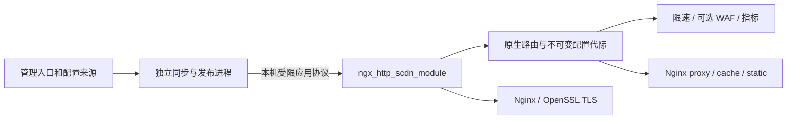

# Lua 业务脚本迁移到 Nginx 原生模块的评估

评估日期：2026-11-13。依据：公开仓库提交 `85e89b0` 的业务源码、同步运行时，以及本地 OpenResty 1.31.8.1 所带 Nginx 1.31.8 的对应实现。本文的数据面性能结论来自静态分析，尚无新的数据面 C 实现或性能对照；Sync 的角色与身份基础已在 [native-sync](../native-sync/README.zh-CN.md)单独实现。

后续评估已将 Sync 原生插件列为建议先行的独立项目，详见 [Sync 原生插件方案](NATIVE-SYNC-PLUGIN-DESIGN.zh-CN.md)。下文的数据面分析仍成立；“是否按请求执行”影响性能收益判断，不决定一个功能是否适合原生插件化。

## 1. 判断

适合把每请求与每次 TLS 握手所需的自有逻辑迁移为 C 编写的 Nginx HTTP 模块。交付形式建议为一个 `ngx_http_scdn_module.so`，内部按路由、配置代际、限速、指标、TLS 和 WAF 分文件组织；可选能力按构建或配置启用。

Nginx 已有的代理、缓存、静态文件服务、事件循环和 TLS 协议实现继续复用。Sync 建议形成独立的 C 原生组件：协议核心、Nginx 模块和配套同步进程。同步、发布及持久化仍保持进程边界；这是执行位置的选择，不要求继续依赖 Lua。管理界面与通用文件维护另行组织。

这能逐步把自有 Lua 替换为原生实现，同时保留现有同步协议。Sync 的首要收益是统一交付、配置和状态管理；数据面原生化另以每请求开销和运行性能验收，两条工作可以独立推进。

C 比 C++ 更贴合现有 Nginx 的内存池、回调与模块接口，也减少额外运行时依赖。若引入仅有 C++ 接口的成熟 WAF 引擎，可以在隔离的适配层使用 C++，通过 C 接口接入；不能让异常跨越 Nginx 回调边界。

## 2. 现在的负担来自哪里

按当前目录统计，`lua_files/` 的 21 个 `.lua` 文件共 1,188 行；`scdn-sync/lib/scdn_sync/` 的 23 个运行库文件共 2,287 行。测试、第三方依赖和部署模板不属于每请求执行代码。文件数量本身不足以证明 Lua 已成为瓶颈。

| 位置 | 实际行为 | 迁移时应改变的机制 |
| --- | --- | --- |
| `lua_files/lib/route.lua` | 每请求调用注册表、限速和 WAF；URI 最长前缀用线性扫描；代理分发使用内部跳转 | 统一请求上下文，预构建 Host 索引与前缀索引，减少阶段间反复查询和转换 |
| `lua_files/lib/registry.lua` | 每请求读取共享 `gen`；Worker LRU 失效后获取并解码站点 JSON；reload 会执行目录扫描和逐项改共享表 | 配置更新时构建完整不可变索引，Worker 在请求中读取已准备的本地结构 |
| `lua_files/lib/sni.lua` | Worker 证书 LRU 未命中时同步读 PEM 并解析；缓存键只有路径 | 在配置准备期解析证书，以内容版本管理对象，显式处理淘汰与有效期 |
| `lua_files/lib/ratelimit.lua` | 用 `resty.limit.req` 进行共享状态更新；按站点、rate、burst 缓存限速器，无淘汰；`leave()` 为空 | 复用内置限速或设计有界的动态限速状态；并发限制必须补齐请求结束清理 |
| `lua_files/lib/waf.lua` | 每请求创建检查目标并按组循环正则；已使用 `jo`；没有在此显式读取请求体 | 在配置准备期编译规则，定义统一规范化和异步 body 读取；明确检查边界 |
| `lua_files/lib/metrics.lua` | 每请求 4 次共享 `incr`；采集时 `get_keys(0)` 后多轮遍历 | 按 Worker 分区维护计数，固定或有界标签，采集时汇总 |
| `lua_files/src/tier.lua` | 按 URI 计数；未带站点维度；首次插入设置 TTL | 先定义窗口与租户隔离语义，再迁移为有界热度表 |
| `lua_files/lib/panel.lua`、`lib/cluster/control.lua` | HTTP 管理调用可能执行 shell、扫描目录或读写文件 | 将管理执行留在独立进程；C 业务模块只暴露有限的状态与应用接口 |

不能把这些行为全算成 Lua 解释执行：限速共享字典、PCRE 正则及 OpenSSL 已经大量使用 C。直接翻译调用方式会保留锁争用、正则成本与磁盘开销。

现有同步运行时也有已经完成的优化：`runtime/engine.lua` 在准备代际时解析证书与构建 Host 表，请求查表不进行文件或网络 I/O。`runtime/registry.lua` 每 Worker 约 0.1 秒检查一次状态；这是按时间增长的开销，不应与每请求开销混为一谈。原生迁移应保留这一隔离，再减少共享状态读取、JSON/表转换与 Lua 阶段调度。

## 3. 功能的迁移归属

| 能力 | 推荐归属 | 工作重点和限制 |
| --- | --- | --- |
| Host 站点注册、启停、前缀路由 | 自研 C 核心模块 | 配置时构建哈希/前缀索引，请求只查表；保留未知 Host 拒绝与停用行为 |
| 反向代理、静态文件、上游 TLS | Nginx 自带模块 | C 模块输出已校验的路由结果；复用原生代理、超时、重试、buffer、sendfile 等能力 |
| L1/L2/off 缓存区选择 | Nginx 缓存模块 + C 决策 | `proxy_cache` 支持变量选择已声明的 cache zone；选择 `off` 可禁用缓存，不必为此另写缓存引擎 |
| 请求速率与并发限制 | 内置模块优先；动态逐站点参数再自研 | 原生 `limit_req` 的 key 可变，但 rate/burst 是配置时参数，不能直接替代无 reload 的任意逐站点 rate 更新 |
| 流量指标 | C log handler | 按 Worker 分区的有界计数；定义 Worker 崩溃、复用、站点删除后的统计语义 |
| 动态证书 | 优先评估内置动态证书缓存；严格事务要求时自研原生 TLS 适配 | 已核对本地 Nginx 存在变量证书路径和 `ssl_certificate_cache`；其能力不自动等同于现有跨 Worker 准备与提交协议 |
| WAF | 单独的可选 C 子模块或成熟引擎适配 | 保持规则与规范化语义，设置 body、正则与内存上限；完整 WAF 引擎未必比当前精简规则更轻 |
| 热度分层策略 | 可选 C 子模块 | 先固定站点维度、窗口、容量与淘汰；真正的缓存内容迁移另行设计 |
| 加密发布、mTLS、请求验签、拉取、journal、报告 | 独立原生 Sync 组件，含模块与配套 C 进程 | 作为建议先行的插件化项目；保持现有按节点加密与认证，以及业务 Worker 的故障隔离 |
| 面板、CLI、文件维护、stream/RTMP 生成 | 独立管理进程与相应 Nginx 模块 | 不并入 HTTP 数据面模块；避免用一个大模块承载全部管理职责 |

### 3.1 限速迁移需要保留语义

如果接受生成站点配置再 graceful reload，可以先使用 Nginx 内置 `limit_req`、`limit_conn`，自有 C 代码会明显减少。如果必须维持每站点 rate/burst 的无 reload 热更新，则需要自研动态参数读取与有界共享状态，或明确设置有限档位。

当前实现使用 `resty.limit.req`，不能悄悄改成语义不同的简单固定窗口计数。状态键至少要区分站点与可信客户端地址；不能直接信任任意请求提供的转发头。动态 rate 更新时要明确既有令牌/欠额状态如何延续。`conn` 若实现为并发请求限制，还需明确 HTTP/2、HTTP/3 多路复用下的计数单位。

### 3.2 TLS 原生化有两条路线

第一条是模块提供受控的 SNI → 版本化证书路径映射，交给 Nginx 的动态证书和缓存功能处理；未命中或过期时仍可能有文件读取、解析成本。版本化文件名能减少同路径覆盖时的缓存陈旧问题，但需要验证证书和路由一起生效的要求。

第二条是在每 Worker 准备阶段加载并校验证书对象，由原生 TLS 回调选择；它更接近现在的配置事务，也需要正确管理 `X509`、`EVP_PKEY` 和 SSL 对象的引用。优先复用 Nginx/OpenSSL 的加载与校验能力，不另写密码学算法。

两条路线都必须测试 HTTP/1.1、HTTP/2、HTTP/3、会话恢复、未知 SNI、过期证书、证书轮换和停用站点。原生回调与 `ssl_certificate_by_lua*` 应有明确的互斥接入方式，不能各自覆盖同一 SSL_CTX 回调。HTTP Host/authority 的访问检查仍应逐请求执行，不能只依赖握手时的 SNI。

### 3.3 缓存选择不等于缓存迁移

当前 `flush_l1_to_l2.lua` 通过目录遍历和 `cp/mv` 复制缓存文件。Nginx 的文件缓存同时维护共享索引、锁、文件头和管理进程；把文件复制到另一缓存目录，不等于目标 cache zone 已正确接纳该对象。

因此第一阶段只迁移 L1/L2/off 的策略选择，继续由 Nginx 写入和维护各 cache zone。跨层迁移、晋升/淘汰及崩溃一致性要作为独立项目验证。不能把现在的复制脚本直接塞进 C Worker 或 timer；timer 内的同步 I/O 同样会阻塞事件循环。

### 3.4 WAF 保持能力一致，再优化

当前六组共 39 条精简规则，不能描述为完整 OWASP CRS。`ngx.re.find(..., 'jo')` 已调用 PCRE JIT/缓存；C 化可能减少目标构造和跨接口调用，但不消除正则匹配本身的成本。

先把现有规则转换为语言无关的数据，建立请求样本的允许/拒绝/规则 ID/评分对照；再在配置阶段编译 PCRE2 并使用匹配限制和有界缓冲。body 读取必须走 Nginx 异步请求体 API，明确大 body、落盘、压缩、JSON、multipart 与异常编码的处理政策。不能默认全量缓冲后同步扫描，也不能以静态扩展名或不完备的危险字符预筛选代替原规则覆盖。

## 4. 建议的组件边界



建议的源码组织是一个安装单元，而非每个 Lua 文件都拆成一个 `.so`：

```text
nginx-scdn-module/
  config
  src/
    ngx_http_scdn_module.c
    ngx_http_scdn_config.c
    ngx_http_scdn_snapshot.c
    ngx_http_scdn_route.c
    ngx_http_scdn_limit.c
    ngx_http_scdn_metrics.c
    ngx_http_scdn_tls.c
    ngx_http_scdn_waf.c
  tests/
  examples/
```

核心模块只在需要的阶段执行：较早阶段解析站点并固定版本；preaccess/access 执行限制和 WAF；log 阶段记录有界指标；证书回调选择已准备的证书。静态内容与反代仍交给 Nginx 已有 content handler。上游连接池、DNS 与 SNI 必须跟随既有代理语义单独验证，换成 C 不会自动修复动态上游的连接复用问题。

对配置热更新，复用独立 Sync 组件的运行时，保留现有 `/status`、`/stage`、`/commit`、`/rollback`、`/finalize` 的操作语义和鉴权，避免数据面再实现一套事务状态。正式替换前要以当前 schema 和错误行为进行兼容验证；当前 Lua 单元测试不能直接证明 C 实现正确，真实进程测试也要更换接入配置后重新执行。

## 5. 真正困难的是多 Worker 生命周期

新的 C 模块应保留以下事务：接收有界配置 → 校验 → 每 Worker 构建完整索引、规则和证书 → 所有存活 Worker 就绪 → 切换活动版本 → 探测 → 持久报告。任一步失败保留旧版本，并保留可回退状态。

1. 共享区保存有界的序列化配置或经过严格校验的偏移结构，以及版本和准备状态。Worker 本地保存自己的指针、内存池、哈希、正则和证书对象。不能把一个进程的普通指针放进共享内存供其他 Worker 解引用。
2. 请求固定一个完整代际；跨 Worker 活动标记使用明确的同步与内存可见性规则。新生 Worker 未准备好时不能拿半成品服务。Worker 身份需区分重启前后的同一槽位。
3. 配置切换不能立即释放旧代际。请求结束、内部重定向、子请求、已有 TLS/QUIC 对象和回退窗口都可能延长生命周期，需要引用管理和回收上限。
4. Nginx 的内部重定向与 named location 会清空模块请求 ctx；必须明确保留或重新关联已固定的代际、路由和统计信息，并验证只计数一次。这是迁移时的约束，不将其直接当作现有系统已复现的故障。
5. 解析、正则编译和证书准备即使发生在 timer 中，仍占用 Worker。需要大小/复杂度边界与分批调度；单个无法拆分的重任务要考虑进程隔离。配置接口也不能用无限量同步解析阻塞业务。
6. 业务 Worker 不持有 Node 长期解密密钥或请求签名密钥，但为 TLS 服务仍需要已生效站点私钥。维持现有隔离与文件权限，回收敏感缓冲时按实际内存所有权处理。

计数器可以按 Worker 分区并按 cache line 对齐，减少每请求争用；导出过程也需要明确一致性。更严格的跨 Worker 限速仍需要共享同步或等效算法。不能以每 Worker 各计一份、总额度随 Worker 数放大来换取表面性能。

## 6. 构建与交付

模块支持 `--add-dynamic-module` 和 `load_module` 方式交付，并以目标 OpenResty/Nginx 的相同源码及兼容构建条件进行编译。Nginx 加载器会检查模块版本与 ABI 签名；`--with-compat` 不能保证跨任意版本、补丁或构建特性的二进制兼容。至少分别验证目标 x86_64/ARM64、HTTP/2/HTTP/3 和 TLS 库构建。

配置数据可以通过事务无 reload 更新。更新 `.so` 程序本身仍需重新加载模块并通过 reload/重启流程部署；两个过程不能混为同一种热更新。首轮保持为外置模块，只有确实受到公开扩展点限制时再评估最小 Nginx 核心补丁。

## 7. 分阶段实施与验收

### 阶段一：基线和隔离原型

记录当前 Lua 实现的正确性与成本，建立单独端口、独立目录的 C 原型，先实现 Host/前缀路由、统一上下文、缓存区选择和指标。原型可先使用启动配置或 graceful reload 来验证原生路径，不直接替换已有无 reload 的生产能力。反代与静态服务沿用 Nginx。

以相同请求、规则、站点数、Worker 数和连接复用配置作对照；分别测 HTTP 缓存 HIT/MISS、TLS 新握手/恢复、路由规模、WAF 开关和限速开关。保存 CPU、cycles/request、RSS、QPS、p50/p95/p99、错误率、上游连接复用率与更新期间延迟。通过开关隔离各项成本，禁止靠关闭安全能力或改变缓存命中率证明 C 更快。

### 阶段二：恢复完整热更新与策略能力

实现 native 代际与原控制协议兼容层，接入 `scdn-sync`；迁移动态限速和 TLS。重新验证所有 Worker 准备、Worker 重建、配置冲突、证书轮换、站点新增/删除/停用、回退、冷启动、Master 失联及正在服务的长连接。

这一步完成后，Node 可由 C 模块承担业务运行时；控制端仍可保持 Lua。要求全过程不降低按节点加密、POST 鉴权、持久化与恢复能力。

### 阶段三：WAF 与可选热度策略

在原规则语义对照通过后迁移 WAF，并增加恶意编码、长输入、body 异步读取、超时及资源耗尽用例。再根据实际需要启用热度策略；缓存文件跨层迁移另行设计与验收。

各阶段使用 ASan/UBSan、解析器 fuzz 和真实多进程故障测试验证内存与生命周期；压测使用正常的优化构建。正式切换前验证备份、回退和原有 Nginx 构建参数，先灰度再扩大范围。

## 8. 可预期收益与尚未证明的部分

可以合理预期减少 Lua 阶段调用、字符串/表构造、共享字典访问次数，以及配置失效后的 JSON 解码；原生索引、按 Worker 计数和准备期证书加载还可能降低抖动。这些收益来自执行路径与数据结构变化。

尚无证据证明当前吞吐瓶颈就是 Lua，也没有新的 C 实现或同条件压测，所以不提供“快几倍”“省多少内存”的数字。PCRE/OpenSSL、共享限速、上游网络和磁盘缓存成本仍然存在；C 也不会自动减少配置事务的功能复杂度。

建议先实施独立原生 Sync 组件并建立 Lua/C 协议对照，再推进 HTTP 数据面模块及其隔离性能对照环境。数据面覆盖路由、指标和缓存选择，复用 Sync 的配置代际，再纳入动态限速、TLS 与 WAF。这样能逐步替换自有 Lua，并保留明确的能力对照与回退路径。

## 9. 主要源码依据

- [`route.lua`](../lua_files/lib/route.lua)、[`registry.lua`](../lua_files/lib/registry.lua)：当前路由、前缀匹配与站点读取。
- [`sni.lua`](../lua_files/lib/sni.lua)、[`ratelimit.lua`](../lua_files/lib/ratelimit.lua)：旧证书缓存与限速状态。
- [`waf.lua`](../lua_files/lib/waf.lua)、[`metrics.lua`](../lua_files/lib/metrics.lua)、[`tier.lua`](../lua_files/src/tier.lua)：规则执行、共享计数与热度语义。
- [`runtime/engine.lua`](../scdn-sync/lib/scdn_sync/runtime/engine.lua)、[`runtime/registry.lua`](../scdn-sync/lib/scdn_sync/runtime/registry.lua)：现有不可变代际、每 Worker 准备与应用接口。
- [`node/apply.lua`](../scdn-sync/lib/scdn_sync/node/apply.lua)：现有下载、事务、journal 与回退调用。
- 本地 Nginx 1.31.8：`src/http/modules/ngx_http_ssl_module.c:808` 的变量证书回调、`:1061` 的证书缓存配置；`src/http/ngx_http_upstream.c:1063` 的变量 cache zone 选择；`src/http/modules/ngx_http_limit_req_module.c:903` 的配置时 rate 解析；`src/http/ngx_http_core_module.c:2662` 与 `:2736` 的请求 ctx 清理；`src/core/ngx_module.c:170` 的动态模块版本与签名检查。
