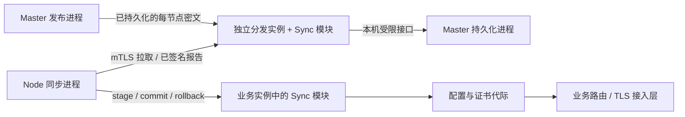

# Sync 原生插件方案

日期：2026-11-13。状态：对现有 `scdn-sync` 0.2.0 的原生化设计。原生模块 0.1.0 已开始实现 Master/Node 角色、身份与只读 API，见 [native-sync](../native-sync/README.zh-CN.md)；加密分发、拉取、应用事务和配套 C 同步进程仍待迁移。原有协议、安全约束和恢复语义作为迁移基线。

原生化前需纳入 [Sync 完整性审查](SYNC-GAP-REVIEW.zh-CN.md)中的新增合同：配置应用与业务健康的区分、前置失败状态、队列永久错误处理、文件提交边界、发布批次及长期保留/恢复策略。旧实现互通只是验收的一部分，不能把旧实现未覆盖的行为直接认定为完成。

## 1. 为什么适合先做 Sync

Sync 已有明确的边界：输入站点与证书数据，生成每 Node 的独立加密发布，认证后分发，由 Node 下载、校验、准备、应用或回退，并报告持久结果。它不需要负责代理响应体、WAF 策略或缓存文件管理。

现有 `master/*`、`node/*`、`runtime/*` 与 `crypto/auth/fs/validate` 已经形成分层。原生化可以沿着这些接口迁移，而不必同时改业务路由和全部安全规则。

因此建议把 Sync 作为首个独立原生插件项目。主要验收目标是统一安装和配置、消除 Sync 对 Lua 运行时的依赖、收敛状态管理和减少集成代码。协议吞吐与资源占用需要实测；不以每请求加速作为它是否值得插件化的唯一依据。

## 2. 一个组件包，两个执行入口

建议原生组件包含以下产物，名称均为设计建议：

| 产物 | 职责 |
| --- | --- |
| `libscdn_sync_core` | 内部公共 C 代码：严格数据校验、发布格式、加密封装、HTTP 签名、防重放、序号、应用事务和存储规则 |
| `ngx_http_scdn_sync_module.so` | Nginx 配置指令、Master 分发接口、Node 配置应用接口、每 Worker 准备与版本选择、状态导出及运行时接入 |
| `scdn-syncd` | 配套 C 程序：Master 文件监听/发布、报告持久化，以及 Node 拉取、解密、journal、应用编排、探测和上报；按角色启动独立服务 |
| 配置模板与服务定义 | 统一的安装布局、显式角色、路径/限额/身份配置与升级方式 |

`libscdn_sync_core` 是共用源码或内部库，不必再交付一个用户手工管理的共享库。模块与程序应使用同一协议实现和兼容版本；通过安装包统一交付，并保持进程间协议兼容检查。

插件封装和进程隔离可以同时实现。将发布与持久化保留在配套进程，能避免磁盘或加密任务拖慢业务 Worker。只增加一个 `server`、location 或 timer 不会建立新的进程隔离；C 中的阻塞操作也会阻塞事件循环。

如果要求所有功能都运行在 `.so` 内，可在独立 Nginx 实例中启用不同角色，但仍需完成原生非阻塞客户端、分批任务及持久化隔离。暂不推荐为启动自定义 helper 进程而依赖 Nginx 私有进程管理接口或增加核心补丁。

## 3. 角色与现有实现的对应关系

| 角色 | 现有 Lua 实现 | 原生归属 |
| --- | --- | --- |
| Master 监听与发布 | `master/watch.lua`、`source.lua`、`publish.lua` | `scdn-syncd` 的发布角色；读取有界完整输入、稳定窗口合并、加密并原子提交 desired |
| Master 分发 | `master/distributor.lua` | 模块部署在独立分发实例；mTLS 身份映射、每 Node 授权、ETag、文件下载与报告转交 |
| Master 报告持久化 | `master/service.lua`、`ingest.lua` | 配套持久化角色；验签、防重放、幂等、持久状态与 ACK |
| Node 同步 | `node/daemon.lua`、`apply.lua`、`outbox.lua`、`probe.lua` | `scdn-syncd` 的 Node 角色；拉取/恢复/应用编排/报告，不依赖业务请求触发 |
| Node 业务配置运行时 | `runtime/registry.lua`、`engine.lua` | 模块加载到业务实例；只处理本机有限控制接口、内存中的配置代际及业务读取 |

Master 发布、分发和持久化可由同一安装包配置，但部署时保持独立角色。Node 的同步进程与业务 Worker 分开运行。统一交付不承诺减少到单一进程。

## 4. 插件接口应解决的安装负担

模块应通过少量 Nginx 指令选择角色、配置路径、共享区与内部接口，替代散落的 `init_by_lua`、`init_worker_by_lua` 和 `content_by_lua` 接入代码。模块本身不依赖 Lua。

例如可设计 `scdn_sync_role`、`scdn_sync_config`、`scdn_sync_zone`、`scdn_sync_api` 等指令；这里只表达配置方向，具体指令及上下文须在实现时确定。分发、Node 控制和业务读取按角色显式启用，避免在业务公网监听器误启用管理入口。

运行配置改用受限的结构化数据，并只保存密钥文件路径。现有运行配置中的 `require`、`config.read` 和 `dofile` 不能直接当作 C 配置执行，需要迁移工具与显式校验。站点输入可保留 JSON；为兼容旧 `return { ... }` 站点文件，可迁移现有数据字面量解析器，仍不执行任意 Lua。

业务读取提供稳定的 C 接口或 Nginx 变量，并由 Sync 模块持有代际生命周期。后续路由、TLS、WAF 等模块消费同一配置来源，避免各自复制版本、证书与事务逻辑。已有 Lua 业务可在过渡期使用薄适配层；适配层属于旧业务接入，不成为原生 Sync 的运行前提。

## 5. 必须保留的协议行为

- 站点配置和证书材料按 Node 独立加密，继续使用现有 JWE/JWS 固定算法与封装规则。密码学使用 OpenSSL 等成熟实现。
- mTLS 节点身份、固定请求签名、正文摘要、时效、nonce 与权限检查继续有效；不能仅凭网络位置或内容摘要授权。
- 完整快照、单调序号、不可变发布、过期与续发、删除和停用行为保持一致。
- Master 在全部不可变文件落盘后才推进 desired；写失败、半写输入或单 Node 发布失败不能破坏既有发布。
- Node 先验证，再下载并准备；在全部目标 Worker 就绪后提交，探测通过并持久化后报告；失败可回退、重启可恢复。
- `status/stage/commit/rollback/finalize` 保持已认证本机接口和现有事务语义。
- 日志与错误只输出受控标识、阶段、摘要和错误码；不记录密钥、凭据、明文站点正文或完整密文体。

兼容性要包括字节编码、HTTP 签名覆盖字段、JWE OAEP/MGF1 参数、JSON 重复键与整数处理、序号比较和错误行为。C 实现不能仅以“调用了相同加密算法”认定与旧实现互通。

## 6. 原生实现的关键约束

本机应用接口与分发接口使用 Nginx 原生事件和请求体读取方式，限制体积、超时、并发和队列。独立 Node 客户端可使用支持 mTLS 与明确超时的成熟 C 网络库；不依赖 shell 调用 curl。

目录扫描、证书读取、完整快照构建、加密、`fsync/rename` 和报告落盘在对应的配套角色中执行。需要低延迟文件通知时可以用 inotify 唤醒，但仍以完整内容核对为准，处理事件溢出、原子替换、目录重建和稳定窗口，保留定期对账。

业务实例共享区保存有界数据和版本状态；各 Worker 构建自己的哈希、规则及证书对象。提交需要校验实际 Worker 身份和就绪状态。请求、TLS 对象与回退窗口仍持有旧版本时不能释放；新生 Worker 未准备完成时拒绝服务并恢复到当前版本。

原生版本要维持现有权限和身份边界。Node 同步进程持有长期解密/请求签名密钥，业务实例只获得其服务必需的站点材料。停用或撤销 Node 时同步更新分发授权和信任配置。

使用 `.so` 交付仍需要匹配目标 Nginx/OpenResty ABI。配置热更新与程序升级分别设计；首轮以外置模块和受监督的配套服务实现。

## 7. 迁移顺序与完成标准

1. **提取兼容合同**：从现有实现提取脱敏协议样例、schema、错误与事务状态。把独立 JOSE/HTTP 签名实现、文件与恢复规则作为原生实现的对照。
2. **实现公共 C 核心**：先验证 Lua 发布 → C 接收与 C 发布 → Lua 接收，以及签名、篡改、过期、防重放和身份隔离。完成解析器 fuzz 与内存检查。
3. **替换 Master 角色和 Node 同步进程**：过渡期可对接原应用接口，验证持久化、重启、ACK 丢失、报告队列、监听、续发与单节点隔离。
4. **替换 Node 原生应用运行时**：兼容原事务接口，验证多 Worker、证书切换、回退、冷启动与正在服务的连接。随后移除 Sync 专用 Lua 依赖。
5. **统一打包与灰度验收**：验证安装/升级/回退、服务账户、systemd、目标架构与 TLS/HTTP 版本；在目标机器建立备份和回退点后再切换。

此前 54 项模块测试和 48 项真实进程检查是旧实现的基线，不是新 C 实现的通过证明。Lua 内部单元测试需要对应的原生测试；进程测试也需要更新启动配置后重新运行。资源验收关注 Node 数、快照/证书规模、发布 CPU、分发并发、同步时延、业务 p99 及磁盘阻塞时的隔离。

Sync 的完成标准应是：可单独安装配置；自身不依赖 Lua；原协议互通与原恢复语义通过；保留安全和故障隔离；业务通过稳定接口使用已应用配置。后续业务 C 模块可以直接复用它，不再另建同步与版本管理。

## 8. 源码依据

- [Master 发布](../scdn-sync/lib/scdn_sync/master/publish.lua)、[文件监听](../scdn-sync/lib/scdn_sync/master/watch.lua)、[分发](../scdn-sync/lib/scdn_sync/master/distributor.lua)、[持久化入口](../scdn-sync/lib/scdn_sync/master/service.lua)。
- [Node 常驻进程](../scdn-sync/lib/scdn_sync/node/daemon.lua)、[应用编排](../scdn-sync/lib/scdn_sync/node/apply.lua)、[报告队列](../scdn-sync/lib/scdn_sync/node/outbox.lua)。
- [Worker 配置运行时](../scdn-sync/lib/scdn_sync/runtime/engine.lua)、[接入与控制接口](../scdn-sync/lib/scdn_sync/runtime/registry.lua)。
- [原测试方法](../scdn-sync/tests/README.md)与[数据面评估](NATIVE-MODULE-ASSESSMENT.zh-CN.md)。
