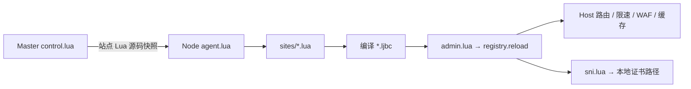
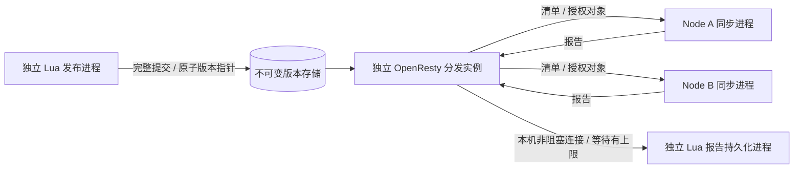

# SCDN Lua/OpenResty 站点与证书同步插件设计

审阅日期：2026-11-08。状态：独立插件 0.2.0 已在 `scdn-sync/` 实现，包括 Master 原站点文件变更自动发布；模块测试和隔离 Linux/OpenResty 联调的实际通过项目见 `scdn-sync/tests/README.md`。本文保留总体设计和后续验收要求，不将尚未实现的管理能力或生产接入描述为完成。

已确认采用现有 Lua/OpenResty，开发独立插件；同步方向为 Master → Node。站点更新包括域名、回源、缓存、WAF、启停和删除。现有静态目录通过配置引用，HTML、JS、图片等文件不进入本插件的发布协议。

当前优先设计同步、故障隔离和多节点并发。面板与 CLI 接入暂缓；文中的相关入口仅记录后续接入位置，不是同步进程的运行依赖。

协议硬性要求：Master → Node 的站点配置、证书链和私钥采用**按节点加密的应用层密文**下发，并保留 HTTPS/mTLS；所有 POST 接口必须认证调用者并检查操作权限。Base64、LuaJIT 字节码和发布签名都不能代替加密。具体封装、请求鉴权与重放保护见第 10 节。

## 1. 源码阅读范围与结论

本文围绕公开的 `lua_files/` 业务模块与 `scdn-sync/` 同步插件描述接口、数据模型和验收要求。配置示例使用保留域名与通用目录，不包含真实站点或部署数据。

原始业务链路为：



现有代码已经支持本机站点管理、Lua 注册表、SNI 选证、按 URI 前缀路由、请求限速、六组 WAF 规则和指标。集群部分属于基础快照拉取，尚缺完整的站点与证书发布事务。

| 直接影响同步的事实 | 源码位置 | 插件需要解决的问题 |
|---|---|---|
| Master 快照只包含 `{name, source}` | `lua_files/lib/cluster/control.lua:15`、`:66` | 证书文件、私钥和证书版本没有进入同步 |
| Node 对返回的每个站点写文件，不对本地集合做删除对账 | `lua_files/cluster/agent.lua:44` | Master 删除站点后，旧 `.ljbc` 仍可能被加载 |
| 编译和本机 reload 结果没有检查，随后写 version | `lua_files/cluster/agent.lua:48` | 下载成功可能被误报为生效成功 |
| 注册表先删除旧 Host 键，再逐条写入新配置 | `lua_files/lib/registry.lua:23` | 读请求可能遇到缺键或混合版本，写入失败也未阻止发布 |
| 证书 LRU 键只有证书路径和私钥路径，无 TTL/版本 | `lua_files/lib/sni.lua:19` | 相同路径覆盖证书后，Worker 可能继续使用旧证书 |
| SNI 加载失败会尝试默认证书，安装结果未检查 | `lua_files/lib/sni.lua:53`、`:64` | 故障可能被默认证书掩盖，无法据此确认更新成功 |
| 集群接口使用查询串 token，默认 Agent 配置为 HTTP | `lua_files/lib/cluster/control.lua:60`、`lua_files/examples/agent.conf.example` | 需要独立节点身份、TLS 和明确的接口权限 |
| 快照版本采用 MD5 内容摘要 | `lua_files/lib/cluster/control.lua:32` | 摘要不能证明发布者身份，也不能阻止旧发布重放 |
| Master 上报状态使用同一个 state.json 读改写 | `lua_files/lib/cluster/control.lua:38` | 多 Worker 并发报告可能互相覆盖 |
| 站点定义通过 loadfile 执行 | `lua_files/lib/registry.lua:10` | 新同步协议应传配置数据，避免将配置修改变成远程执行 Lua |
| CLI 还会生成 stream/RTMP 配置 | `lua_files/cli/sitectl.lua:176`、`:198` | 这些能力需要独立的 Nginx 配置发布策略，不能混入 HTTP 热更新 |

还需保留两项能力边界：`ratelimit.lua` 的 `conn` 当前没有实际连接限额实现；六个 WAF 文件共 39 条精简规则。插件只同步已有可执行配置，不把字段存在当作能力已实现，也不自动替换已有 WAF 引擎。

## 2. 插件结构与职责

插件暂名 **scdn-sync**，提供 Master API、Node Lua 同步进程和 OpenResty 运行时适配三个部分。


这里的 Master 是业务控制节点，与 Nginx 自身的 master 进程分别命名和处理。

| 部分 | 职责 |
|---|---|
| Master 发布模块 | 保存站点草稿、导入证书、冻结完整节点配置、按节点加密并签名、推进期望版本、跟踪发布结果 |
| Master 同步 API | 认证节点，返回该节点的清单及被授权证书对象，接收幂等报告 |
| Node 同步进程 | 使用 `resty` 运行 Lua 常驻进程，主动拉取、校验、落盘、调用本机应用接口、重试与恢复 |
| Node 运行时模块 | 维护不可变配置代际、预载证书、切换注册表、报告每个 Worker 的准备和生效状态 |
| 现有业务模块 | 按当前站点表继续执行路由、缓存选择、限速、WAF 和指标记录 |

网络下载、版本目录管理和恢复由 Node 独立同步进程承担。业务请求和 TLS 握手只使用内存中的配置与解析后的证书。Worker 的准备阶段需要解析证书，应分批执行并设置容量上限；这部分启动成本需要真实 OpenResty 测量。

第一版采用节点主动短轮询，适合现有 Master → Node 的逻辑和节点位于 NAT 后的情况。后续可以增加更新通知，但通知只负责唤醒拉取，完整快照仍是恢复依据。

Master 侧的发布构建、同步分发和报告落盘需要隔离：站点扫描、签名、文件持久化不放在同步分发 Worker 的请求处理中。详见第 9 节；仅将 Node Agent 独立运行，尚不足以解决 Master 并发阻塞。

## 3. 站点、证书与发布的数据关系

### 3.1 稳定标识与完整快照

站点使用稳定 `site_id`，`name` 作为显示名称。证书使用 `certificate_id + version`，每次导入或续期产生新版本。一次发布包含某个节点托管范围的**完整站点集合**及所需证书引用，避免连续增量丢失后无法恢复。

每份清单同时带有：

- `node_id`：接收节点，必须与 mTLS 身份一致。
- `scope_id`：插件托管范围，限制删除与清理的边界。
- `revision_id`：本次不可变内容版本。
- `desired_seq`：Master 为该节点递增的发布序号，使用十进制字符串比较，避免 Lua number 的大整数精度问题。
- `release_id`：把同一次跨节点发布关联起来。
- `issued_at / expires_at`：传输与首次应用的有效窗口。
- `sites / certificates / tombstones`：完整配置、证书对象引用与删除审计记录。

回滚也分配新的 `desired_seq`，引用历史内容。不能把较小的旧序号重新发给节点。已经验证并成功应用的版本可在 Master 失联时继续运行；清单过期限制新的应用请求，不自动清空当前站点。

离线节点恢复连接时，如果待应用清单已过期，Master 需要产生新的投递版本与发布序号，可以复用原证书对象；Node 不得忽略过期检查强行应用。

### 3.2 站点配置示例

以下是协议中单个站点的数据形状，字段校验与现有运行能力对应：

```json
{
  "site_id": "site-demo",
  "resource_version": 7,
  "name": "demo",
  "enabled": true,
  "server_names": ["www.example.com"],
  "root": "",
  "upstream": "origin.example.com:8080",
  "cache": {"layer": "l2"},
  "ssl": {
    "enabled": true,
    "certificate_id": "cert-demo",
    "certificate_version": 3
  },
  "rate_limit": {"enabled": true, "req_per_sec": 50, "burst": 100},
  "waf": {"enabled": true, "groups": ["sqli", "xss"], "threshold": 5},
  "locations": [{"prefix": "/api/", "upstream": "api.example.com:9000", "cache": "off"}]
}
```

运行时适配器把证书引用解析为不可变版本的证书对象，并保持 `lib.registry.lookup(host)` 返回的站点结构与 `route.lua`、`waf.lua`、`ratelimit.lua` 兼容。协议不接受客户端指定的证书文件路径、Lua 源码或 Nginx 原始片段。

域名统一转小写、去尾点并校验；第一版延续精确 Host 路由。证书本身可以包含合法通配符 SAN，但通配符站点路由需另行实现，不能由通配符证书自动推导。国际化域名先转换成经校验的 ASCII/Punycode。重复 Host、非法端口、未知 WAF 分组和不支持的字段都在发布前拒绝。

`root` 必须属于节点预先声明的静态目录范围；回源地址、缓存层和数值参数按节点能力校验。`ssl.enabled=false` 表示该站点不提供 HTTPS；已知站点缺少有效证书时不能自动冒用默认站点证书。

## 4. Master 发布与传输协议

### 4.1 发布步骤

1. 管理层准备完整一致的节点输入；草稿及 `resource_version` 的编辑冲突控制留给后续管理层，当前发布 API 不提供草稿 CRUD。
2. 校验站点、域名冲突、目标节点能力、证书 SAN、证书有效期和密钥配对。
3. 冻结各节点完整站点集合、证书版本和目标节点清单，生成不可变 revision。
4. 为目标节点生成独立密文对象和签名密文清单，完整持久化后原子写入其 `desired` 指针。
5. 根据 Node 的真实应用报告推进结果，分别展示期望版本、已下载版本和已生效版本。

证书更新需要找到所有引用该证书的站点和节点，产生新的节点清单。单纯修改 Master 上一个 PEM 文件不会触发隐式生效。

第一版 Master 存储采用单机文件系统：不可变发布目录、每节点独立 desired 文件和每节点独立报告状态，发布写入加进程锁。报告按节点加锁并在持久化后 ACK，不再共享一个读改写的 state.json。发布构建及报告持久化分别由隔离的 Lua 进程承担，通过本机协议与分发服务交互；不能将普通文件 I/O 放进 timer 后就认定为非阻塞。此设计没有承诺多 Master 高可用或大规模节点吞吐。

### 4.2 对外与本机接口

以下接口已在独立插件中实现；生产服务没有自动接入：

| 接口 | 调用者 | 强制鉴权与语义 |
|---|---|---|
| `GET /_scdn_sync/v1/desired` | Node → Master | mTLS 节点身份与节点状态校验；返回本节点签名密文，ETag 为密文封装摘要 |
| `GET /_scdn_sync/v1/objects/{sha256}` | Node → Master | mTLS + 本节点发布对象授权；只下载密文，摘要不能充当下载凭据 |
| `POST /_scdn_sync/v1/reports` | Node → Master | mTLS + 节点请求签名 + 时效/重放检查；只更新本节点的合法投递结果 |
| `POST /_scdn_sync/v1/heartbeat` | Node → Master | mTLS + 节点请求签名 + 时效/重放检查；只更新本节点心跳 |
| `POST /__scdn_sync/v1/stage` | 本机同步进程 → Node OpenResty | 受限 Unix socket/loopback + 独立 token 请求头；检查本机事务与发布范围 |
| `POST /__scdn_sync/v1/commit` | 本机同步进程 → Node OpenResty | 同上；绑定已准备事务和预期旧 revision，不能任意提交版本 |
| `POST /__scdn_sync/v1/rollback` | 本机同步进程 → Node OpenResty | 同上；只回退当前事务的上一版本 |
| `POST /__scdn_sync/v1/finalize` | 本机同步进程 → Node OpenResty | 同上；结束提交/回退，释放非活动内存代际 |
| `GET /__scdn_sync/v1/status` | 本机同步进程 → Node OpenResty | 本机凭据校验；仅返回版本、阶段与 Worker 状态 |

本机回退使用受保护的 rollback/finalize 操作，绑定当前事务的上一版本与 journal。不能开放“提交任意 revision”的通用管理接口。当前由受信任的本机 Lua 调用发布模块；站点 CRUD、面板和管理 CLI 暂缓。

Master 对 Node 使用 HTTPS + mTLS；客户端证书映射到配置中的节点身份，而不是信任请求体中的 `node_id`。远程 POST 另外要求已登记节点密钥的请求签名；证书身份、签名密钥归属和请求体节点必须一致。节点只可读取自身当前发布、进行中的发布及必要恢复窗口内的密文对象。管理权限和节点同步权限分离。配置及证书对象响应设置 `Cache-Control: no-store`，不使用查询串凭据。

Node 本机接口绑定受限 Unix socket，或明确绑定 loopback，并要求独立随机 token 请求头。它不复用旧 `.admin_token`，也不信任清单提供的本机 URL。

### 4.3 加密、签名与幂等

清单采用标准 JWE 加密后，再以 JWS 签名封装。第一版固定 JWE 算法为 `RSA-OAEP-256` + `A256GCM`，发布签名为 Ed25519；禁止根据未受信的算法字段自动降级。Node 先用固定信任的 Master 发布公钥验证 JWS，再用本机独立解密私钥解密 JWE，通过认证标签后才解析配置 JSON。签名验证标准封装的原始签名输入，不重新序列化 JSON 参与验签。清单内引用的是本节点证书密文对象的 SHA-256；具体格式与密钥职责见第 10 节。

Node 固定信任发布公钥，检查节点受众、协议版本、有效期、大小和发布序号。同一序号只能对应同一摘要；较旧序号拒绝，同序号同内容可以重试。公钥轮换与 Master 恢复需要显式信任迁移，不能通过下发更小序号绕过检查。

报告绑定节点、release、desired_seq、revision_id、稳定 request_id 和单调 report_seq。Master 持久化幂等收据后 ACK；重发同内容返回同一结果，旧发布的迟到报告保留幂等收据，不覆盖新期望状态。当前没有独立的完整报告历史查询接口。

可配置初始值：5 秒轮询并加入抖动，10 秒心跳，45 秒无心跳视为离线，故障后指数退避至 60 秒。清单、单个证书链、单个私钥及合并运行时快照分别设置大小上限；安装时根据 shared dict 和 Worker 内存预算计算可接受容量，超过上限整批拒绝。这些是实现参数，不是性能验收结果。

## 5. Node 应用事务与崩溃恢复

### 5.1 不可变目录

```text
/var/lib/scdn-sync-node/
  releases/<revision_id>/
    manifest.jws
    objects/<ciphertext_sha256>.jwe
    runtime.json
  applied.json
  journal.json
  reports/
```

持久目录由专用身份拥有，私钥及含秘密的快照限制为 0600；临时文件同样受限。路径由插件根据经校验的 ID 生成，限制在托管根目录内并拒绝符号链接逃逸。证书链和私钥解密校验后嵌入本机 `runtime.json`，当前不单独输出 PEM 文件。只有完整快照可登记为候选事务。

收到的 `manifest.jws` 和 `.jwe` 对象保持密文；解密后的配置和 PEM 仅存在于 Node 运行内存及受限的 `runtime.json`，供应用与重启恢复。此处要求的是跨主机文件加密下发，不把运行时需要解密描述成 Node 已具备完整磁盘加密；明文不得回传到下载接口、日志或报告。

安装时验证同步进程与 OpenResty 启动加载器的读取身份。如果沿用 root master / 非特权 Worker，由 Nginx master 初始化时加载受限快照，再交给 Worker 使用；不通过把私钥改成全局可读来解决权限问题。

文件写入使用同目录临时文件、文件 fsync、原子 rename 和目录 fsync。目录切换、shared dict 更新和健康检查不能组成跨存储原子操作，因此必须使用 journal 恢复，不能只靠一个 version 文件。

### 5.2 应用状态机

```text
received → verified → staged → prepared → activated → healthy → applied
                                      ↘ failed / rolling_back → rolled_back
```

1. **verified**：发布签名、密文对象摘要、JWE 解密和认证标签、受众、序号、配置 Schema 全部通过。
2. **staged**：完整目标快照落盘，全部证书可解析、链与私钥配对、SAN 与站点匹配。此时继续服务旧版本。
3. **prepared**：调用本机 stage，把候选快照放入专用 shared dict。所有当前接收新请求的 Worker 都加载同一候选版本，并预解析所需证书，逐个确认成功。
4. **activated**：保存含上一已生效版本的 journal，在本机锁内检查预期旧版本，并以一次 shared dict 写入切换 active revision。
5. **healthy**：确认所有服务 Worker 识别新版本；检查路由和一次新的完整 TLS 握手，核对证书指纹与域名。探测可以按变更范围执行，但不能只用同步进程中的变量证明生效。
6. **applied**：将包含 revision、发布序号、密文摘要和本机快照摘要的 `applied.json` 持久化，再持久化报告、finalize 并清除 journal。成功报告发出前必须已有可恢复的生效记录；可见文件不等于 fsync 成功，恢复时须重新确认持久化。

Node 同步进程使用独占进程锁，一次只处理一个应用事务。候选共享内存写入必须使用 `safe_add/safe_set` 并检查每个返回值，内存不足时保留旧版本。Master 已提交的密文封装不可变；Node 对同一候选的重试可重新原子写入相同内容，不能改变其序号/摘要。

### 5.3 Worker 的一致性语义

`lib.registry` 对外保留 `lookup/hosts`，内部增加不可变快照和 active revision。每个 HTTP 请求首次查找时把快照固定到请求上下文，后续路由、WAF、缓存选择和日志读取相同快照。每次 TLS 握手独立固定一个快照，SNI 与证书从同一快照取值；TLS 阶段的 `ngx.ctx` 不当作 HTTP 请求上下文使用。

候选发布需收齐当前服务 Worker 的准备确认，确认记录包含 PID 和启动标识，不能仅以可复用的 Worker 编号计数。Worker 集合变化时重新核对；新 Worker 初始化时先加载当前完整快照，未准备好不得返回旧版站点作为降级结果。

单个 active 指针保证一次查找不会看到“半张表”。已开始的请求可以完成旧快照；新的请求使用新快照。证书轮换作用于新的完整 TLS 握手，已有 TLS 连接或会话恢复不重新展示证书。这不能描述成所有连接同时切换或已验证无损。

两份专用 shared dict 分别存放不可变运行时快照、active/prepare/Worker 状态。运行时快照含证书材料，不能作为调试响应或指标输出；控制口只返回版本、指纹和阶段。Worker 通过准备阶段解析 PEM，握手路径使用已解析对象。

### 5.4 失败与启动恢复

| 失败点 | 处理 |
|---|---|
| 下载中断、摘要错误、证书不匹配、配置非法 | 候选不会进入 active，旧版本继续运行；当前磁盘材料保留，自动清理待实现 |
| 某个 Worker 准备失败或超时 | 不切 active；事务报告受控错误码，具体 Worker 可在鉴权 status 中检查 |
| active 切换失败 | 保留旧版本，不写 applied |
| 新版本健康检查失败 | 用已保留的上一完整快照恢复 active，再验证旧版本，报告失败及回退结果 |
| 回退也失败 | 停止继续应用其他版本，保留 journal 与恢复材料，日志记录受控错误码；未确认回退前不发成功 ACK |
| 切 active 后、写 applied 前进程退出 | 启动时根据 journal 恢复上一已确认版本，再对最新 desired 重新对账 |
| applied 已落盘、报告未 ACK | 恢复该版本并重发同一成功报告，避免重复应用 |
| Master 不可达 | 保留当前已生效配置和待 ACK 报告，按退避重连 |

OpenResty 冷启动与同步进程恢复共用同一套 `applied + journal` 选择规则。恢复选择只信任最后持久化成功的版本，不能从目录名或未完成事务推断成功。回退过程中仍保留已见过的最高发布序号，防止重新接受旧清单。

## 6. 证书同步与删除的具体规则

证书版本先下载、校验并由各 Worker 准备，站点引用随后随同一 active 指针切换。每次证书缓存查找使用 `revision + certificate_id + version + 证书指纹`，正缓存和负缓存都关联版本；无需依赖在某一个 Worker 调用 flush 来通知所有 Worker。

SNI 入口从当前快照选择域名和证书，检查 `ngx.ssl.clear_certs/set_cert/set_priv_key` 的返回值。未知 SNI、已停用站点和证书故障按明确策略拒绝；只有配置了独立默认站点时才使用其证书。证书生命周期中不原地覆盖已有 `privkey.pem`。

Master 删除站点后，新快照不再包含该站点，并带删除记录用于审计。Node 按完整期望集合从新注册表移除，不能依赖删除某个 Lua 文件作为生效机制。停用同样需要发布：配置可以保留，但新路由与 SNI 不提供服务。

旧版本在回滚保留窗口及 Worker 排空完成前不清理，证书仍被任何保留版本引用时不得回收。清理只遍历插件自己的索引和目录，不扫描删除其他证书目录或原有业务目录。回退前重新检查证书有效性及禁用状态，过期或被隔离的证书版本不能作为可用回退目标。

第一版接收外部签发或续期产生的证书对，通过受信任的本机 Lua 发布 API 指定版本并发布；相同节点的 certificate ID/version 不允许替换为不同材料。证书签发、ACME 账户和 DNS 验证可由现有运维链路完成；不在本次同步协议中分发 CA 私钥或 DNS 账户凭据。

## 7. 与现有代码的接入位置

已创建的独立目录如下；原始 `lua_files/` 保持原样，以兼容包路径选择接入：

```text
scdn-sync/
  lib/scdn_sync/master/      # publish、distributor、service、ingest、source、watch
  lib/scdn_sync/node/        # daemon、apply、outbox、probe
  lib/scdn_sync/runtime/     # engine、registry、本机控制与 SNI
  lib/scdn_sync/             # 校验、JOSE、请求鉴权、文件和 HTTP
  compat/lib/               # lib.registry / lib.sni 可选适配
  bin/node.lua              # 独立同步进程入口
  bin/watch.lua             # 独立 Master 文件变更监听入口
  conf/                     # 独立 Master 配置与 Node 片段
  examples/                 # 受信任本机配置模板
  deploy/                   # systemd / tmpfiles 示例
  tests/                    # 模块与真实 Linux/OpenResty 联调
  vendor/                   # 固定 HTTP 库和 TLS 辅助模块
```

| 现有文件/入口 | 接入方式 |
|---|---|
| `lib/registry.lua` | 启用插件时委托版本化注册表；保留外部查找接口，托管站点不再执行远端 Lua |
| `lib/sni.lua` | 委托版本化 SNI 模块，消除相同路径覆盖和单 Worker 缓存失效问题 |
| `lib/route.lua`、`lib/waf.lua`、`lib/ratelimit.lua` | 使用请求固定的站点配置，按现有参数执行；补充类型和返回值边界 |
| `lib/metrics.lua` | 保留站点流量指标，补充受控的发布/错误指标；不输出秘密 |
| `lib/admin.lua` | 增加独立受保护的插件控制入口，旧 reload 不得绕开托管版本事务 |
| `lib/panel.lua`、`cli/sitectl.lua` | Master 端转入草稿和发布；Node 端对已托管站点禁止直接覆盖 |
| `lib/cluster/control.lua`、`cluster/agent.lua` | 对同一托管范围完成交接后停止旧链路写入，保留可恢复备份 |

首次接入须导入该业务实例的完整托管站点集合，并交接唯一写入者。兼容层不再调用旧 loader，因此删除不会由旧字节码自动复活。当前没有自动合并非托管站点的第二注册表；若存在非托管范围，应保留在独立实例或先制定明确的迁移策略。

业务 Lua 仍可按 `build.sh` 在目标节点编译成 `.ljbc`；**站点配置使用 JSON 数据模型，跨主机以 JWE/JWS 密文传输，Node 验签解密后验证，不作为 Lua 程序或字节码分发**。不同 LuaJIT 架构也不互传运行时代码字节码。

依赖以目标 OpenResty 为准：`cjson.safe`、`resty.lrucache`、`ngx.ssl`、`resty.lock` 及 `resty.openssl` 提供基础接口。本地解包源码已定位到证书密钥配对、签名、RSA 与 AEAD 基础接口，不证明已有可用的完整 JWE/JWS 或 HTTP Message Signatures 实现。需要固定经审查的协议实现，使用标准向量和独立实现交叉验证，再验证目标 TLS/密码库的兼容性。`lua-resty-http` 需要显式固定版本并随插件供应，当前业务源码不能证明节点已安装。文件锁、fsync 和安全 rename 由受限 POSIX FFI 模块提供，不拼接 shell 命令。

HTTP 运行参数的热更新在完成一次接入后使用上述快照机制。首次安装 Lua 钩子、修改 Nginx 监听/共享内存、修改插件代码，以及原有 stream/RTMP 配置，仍按 `nginx -t` 和受控 reload 流程处理；这些操作不能使用站点 JSON 热更新代替。

Master 文件钩子由独立 `bin/watch.lua` 实现。按 scope 绑定源目录及目标 Node，默认每秒扫描原 `.lua`/`.json` 站点文件和其白名单 PEM 内容；连续稳定 2 秒后调用既有加密发布 API。Lua 源文件按数据字面量解析，不执行代码。新增、原子替换、修改、删除、证书原路径更新均产生完整候选，异常源保留上一 desired；最终空目录发布由 `allow_empty` 控制。源摘要随 desired 原子提交用于重启去重，站点/证书版本仅持久化摘要及单调版本号，过期前自动续发。源文件读取不创建/修改原目录权限，拒绝符号链接。Node 使用既有事务热切换，避免站点更新触发 Nginx reload；接入示例和延迟边界见 `scdn-sync/README.zh-CN.md`。

## 8. 实施顺序与验收

1. **接入准备**：核对目标 Node 当前版本、实际配置与全部写入入口，生成并验证备份/恢复材料；隔离端口安装插件，导入现有站点与证书引用，验证字段兼容。
2. **发布基础**：完成 Master 不可变密文清单、节点 mTLS、逐节点加密、发布验签、POST 请求鉴权和重放保护、Node 完整拉取、dry-run、持久报告和恢复；新增/修改配置先在隔离实例验证。
3. **运行时事务**：完成版本注册表、Worker 准备、版本化 SNI、删除/停用、失败回退；再接入旧管理接口。
4. **批量操作**：添加节点选择、单节点灰度、分批发布、暂停扩大和历史回滚。跨节点状态展示为逐节点结果，不能把部分成功显示为全部完成。
5. **迁移**：在验证备份可恢复后，对指定托管范围交接唯一写入者，再按节点逐步接管。旧链路是否运行必须现场核实，本文不把历史部署文档当作当前服务器状态。

必须覆盖的行为验收：

| 场景 | 成功标准 |
|---|---|
| 新增、多域名、改回源、改缓存、改 WAF | 所有服务 Worker 的版本一致，真实请求体现新配置 |
| 停用和删除 | 新请求无法继续访问旧站点，重启后不由旧 `.ljbc` 复活 |
| 同一路径概念下的证书更新 | 所有新的完整 TLS 握手显示目标版本指纹，不复用旧 LRU |
| 错误私钥、SAN 不匹配、损坏链、过期证书 | 发布/准备失败，原有效站点继续提供服务 |
| 下载中断、shared dict 满、Worker 退出/重建 | 不出现半份注册表，不提前报告 applied |
| 重复清单、旧序号、迟到报告、身份越权 | 幂等或拒绝，不能覆盖更新状态或下载他人私钥 |
| 切换中进程退出、系统重启、报告 ACK 丢失 | 按 journal/applied 恢复，重发报告后状态收敛 |
| Master 离线、Node 暂时离线 | 已生效业务继续，恢复连接后按完整期望状态收敛 |
| 一个节点失败、批量暂停、历史回滚 | 结果逐节点准确，回滚使用新发布序号与完整旧内容 |

实现已放在 `scdn-sync/`，加密和请求签名使用独立实现交叉验证，并提供真实 Linux/OpenResty 进程联调。实际结果以测试说明为准。磁盘历史自动回收、管理层、批量发布控制、跨机高可用、目标服务账户及规模压测仍未验收；没有执行生产部署或接管。

## 9. Master 故障隔离与多节点并发

### 9.1 故障影响必须分层说明

本节 Master 指业务控制节点。它可能是发布模块卡住、分发服务卡住，或整台主机不可用，这三种情况的影响不同。

| 故障情况 | 同步行为 | 已生效业务行为 |
|---|---|---|
| 发布构建进程卡住，分发服务仍健康 | 不能产生新发布；可以继续分发已经完整提交的不可变版本 | Node 继续使用本地配置 |
| 分发服务不可达或卡住 | 新清单与未下载完成的对象等待恢复，Node 超时后退避 | Node 保留当前已生效版本 |
| Master 在 Node 完成整份下载并验证后失联 | 在清单仍允许首次应用的窗口内，Node 可独立完成本机应用；结果先持久保存，恢复后补报 | 无需等待 Master ACK 才开始使用本机验证通过的版本 |
| Master 整机、磁盘或其网络故障 | 单 Master 的新同步暂停；重启进程不能替代服务器高可用 | 无其他依赖故障时，Node 继续服务；证书有效期仍正常流逝 |
| Master 只丢失报告 ACK | Node 重发持久报告，不因 ACK 缺失重复切换或自动回退 | 保持本机已生效版本 |

以上继续服务的前提是 Node 本机和源站健康、配置与证书已在本地。如果源站、DNS 或其他业务依赖也在同一故障主机，仍会受相应依赖故障影响。同步故障不能被展示为 Node 业务已经停止。

如果要求 Master 整机故障后仍可继续分发，需增加位于独立主机的分发副本，并复制已经提交的清单和证书对象；Node 只切换到预先信任的副本。继续接受新配置还需要发布权仲裁与防止双主冲突，不能由多个副本各自递增序号解决。第一版先实现单 Master 的隔离与恢复，不宣称已经具备此能力。

### 9.2 当前脚本的阻塞与竞争证据

- `lib/cluster/control.lua:16` 的 `io.popen(find...)`、`:19` 的管道读取和 `:21` 的普通文件读取在处理请求的 OS Worker 内同步执行；慢磁盘或子进程等待会拖住该 Worker 的其他连接。不同节点每次拉取都会重复扫描和读取整份站点集合。
- `control.lua:74` 到 `:77` 对同一个 state.json 读改写，`:45` 还使用相同临时文件名；多 Worker 并发会有状态丢失和临时文件竞争。增加 Worker 数量不能修复这一问题。
- `cluster/agent.lua:19` 和 `:25` 使用 `curl -m 5`。Master 无响应时，通常先等快照请求超时，再向同一个不可达 Master 上报并再次等待，单次失败可消耗约两次 5 秒网络等待。
- `agent.lua:50` 的本机 reload curl 没有超时；`:48` 的字节码编译也没有独立截止时间。在没有进程级限制时，本地应用阶段可能长期停住。Agent 是否按独立进程运行、是否已有外层服务超时，须检查实际部署后才能确定。
- `lib/registry.lua:21` 的扫描和后续 loadfile 在处理本机 reload 的业务 Worker 中执行。独立 Agent 只能隔离它自己的等待，不能自动隔离这个本机处理器的同步工作。

`ngx.timer`、Lua coroutine、`ngx.thread` 和 `pcall` 都不会把阻塞的普通文件操作或 CPU 计算变成另一个 OS 线程。cosocket 可以让网络等待让出 Worker，但 JSON 解码、签名计算、证书解析、普通 io 与 fsync 仍需分别处理。

### 9.3 Master 的进程边界



分发实例与业务 OpenResty、发布进程使用独立进程和资源预算。只新增 `server {}` 或监听端口，仍会共享原实例的 Worker，不构成进程隔离。磁盘、CPU、内存和网络可能仍是同机共享资源，需对发布大小、下载并发、带宽和工作队列设置上限。

发布进程每个版本只做一次扫描和校验，再为各目标节点提前生成独立密文、签名并落盘。只有完整产物可读且提交成功后才推进 desired；进程在发布中途退出时，分发端继续提供上一完整版本。

分发 Worker 根据节点身份返回已生成的签名密文字节，未变化时返回 304，不在每个请求内运行 find、重建全站点 JSON、加密、发布签名或调用 Node。证书密文对象经权限检查后通过 Nginx 文件发送路径传输；文件冷读仍可能受到磁盘延迟影响，不能据此承诺绝对无阻塞。POST 的节点请求验签仍需受限执行和并发配额。

报告入口经有界本机连接交给持久化进程，按节点更新状态；持久化完成才 ACK。持久化进程不可用或队列满时返回可重试错误，由 Node 保存并重试。不能先返回成功，再把报告仅留在易失的 shared dict 中。

### 9.4 并发规则与背压

| 范围 | 规则 |
|---|---|
| 不同 Node | 各自拉取、各自应用；慢 Node 不持有其他 Node 的发布锁，不等待全体完成才能让其他 Node 下载 |
| 同一个 Node | 初始配置为 1 个清单请求、最多 2 个对象下载、1 个应用事务；参数可配置 |
| 同一 Node 连续更新 | 未开始应用的候选可合并到最新完整期望版本并记录被替代；正在激活的事务先完成或回退，不能中途混入另一版本 |
| Master 分发 | 限制每节点及全局在途请求、连接、响应大小与传输速率；超限返回 429/503 及重试提示，避免无限排队 |
| Master 写入 | 发布串行提交，报告按节点串行；锁不跨网络下载，也不等待 Node 回报完成 |
| Node 报告 | 网络发送可与轮询独立调度，使用有容量上限的持久队列；队列满时停止接收新应用，保留业务当前状态和未确认结果 |
| Node 本机控制 | stage 立即登记事务，status 查询进度；commit 使用短锁切换，不能在控制请求中无限等待所有 Worker |

连接、发送、读取分别设置超时，并增加覆盖整个请求的总截止时间；只设置每次读取超时不足以防止慢速持续发送。超时需作用于实际可取消的 I/O；Lua 定时器无法抢占卡在普通文件调用或连续 CPU 计算里的执行。Worker 预载与证书解析按批执行并让出事件循环，大对象直接拒绝。文件阻塞限制在隔离进程内，仍须监控与故障注入验证。

Node 轮询和重试加入随机抖动，避免所有节点同时启动或故障恢复时集中请求。服务端返回过载时尊重退避，不立即循环重连。每节点状态与持久报告设定独立配额，避免一个异常节点占满 Master 的全部接入能力。

以 5 秒轮询为例，N 个节点的版本检查平均请求量约为 N/5 次每秒：100 个节点约 20 次，1,000 个节点约 200 次；这不包含心跳、报告、对象下载与 TLS 握手。该公式只用于估算请求量，节点支持数必须按实际快照大小、证书数量、带宽与故障行为压测后给出。

### 9.5 补充验收场景

故障测试必须覆盖：挂起发布进程后旧版本仍可下载；挂起分发服务后业务请求仍可完成；一个 Node 慢读时其他 Node 仍推进；Master 报告写入停顿或磁盘满时不误发 ACK；Node 本机控制口无响应时应用超时；大量节点同时上线及 Master 恢复时无无限进程/队列增长。记录业务时延、同步时延、内存与队列峰值，再据此确定默认并发参数。

## 10. 密文下发与 POST 强制鉴权

### 10.1 文件本身按节点加密

HTTPS/mTLS 保护连接；JWE 保护实际发布文件。Master 分发存储和下载接口只提供密文封装，同一份配置下发到 A、B 两个节点也分别生成密文。Node A 的解密私钥不能解开 Node B 的配置或证书对象。

第一版采用标准 JOSE 封装，不自行设计分组模式、填充或密钥派生协议：

- JWE（RFC 7516）使用 `alg=RSA-OAEP-256` 包装随机的 256 位内容密钥，内容使用 `enc=A256GCM`。RSA 节点解密密钥至少 3072 位；OAEP 与 MGF1 都固定 SHA-256，不能误用 OAEP 默认 SHA-1。
- 每个新 JWE 对象生成独立内容密钥和 96 位随机 nonce，GCM 标签为 128 位；使用密码库的安全随机源，禁止重复使用同一密钥/nonce。受保护头按 JWE 规范作为 AAD，固定算法与已登记 `kid`。
- 配置清单使用 JWE Compact Serialization，再用 JWS（RFC 7515 / RFC 8037，`alg=EdDSA` 且密钥类型固定 Ed25519）签名这个 JWE 字符串。Node 先验发布签名再解密，严格校验受保护头类型和算法；不接受 `none`、临时附送的信任公钥或未登记 `kid`。
- 证书链和私钥可作为同一个证书数据对象进行 JWE 加密；密文 SHA-256 在已签名的配置清单内引用。下载完成先核对密文摘要，再解密、核对节点/证书 ID/版本，随后校验证书与私钥。
- 清单明文内部绑定 `node_id`、`scope_id`、`revision_id`、`desired_seq` 和有效期；证书对象绑定 `node_id`、解密 key ID、certificate ID/version。URL 和外层日志只保留必要的对象 ID、摘要与协议元数据，站点配置和 PEM 不放在明文外层。

同一 `(node_id, desired_seq)` 的封装一旦提交即保持不变，重试返回相同密文字节，ETag 和幂等摘要也取密文封装。重新加密、解密密钥轮换或重新投递过期清单都产生新的序号；对象跨版本复用仅限相同目标节点与解密 key ID，避免临时重加密破坏重试一致性。

### 10.2 密钥职责与注册

| 密钥/身份 | 私密材料所在位置 | 用途 |
|---|---|---|
| Master Ed25519 发布签名密钥 | 独立发布进程可读的受限位置 | 证明密文来自被信任的发布者，Node 固定对应公钥 |
| 每 Node 独立 RSA 解密密钥 | 由 Node 本地生成，仅 Node 保存私钥 | Master 使用经登记公钥加密，Node 解密自己的发布 |
| 每 Node 独立 Ed25519 请求签名密钥 | 由 Node 本地生成，仅 Node 保存私钥 | 签名 Node → Master 的 POST 请求，Master 固定其公钥 |
| 每 Node 的 mTLS 客户端身份 | Node 的受限身份目录 | 建立连接与映射节点身份，支持单节点撤销 |
| Node 本机控制凭据 | 仅本机同步进程和控制接口可读 | 保护 stage/commit/status，与远程节点密钥隔离 |

节点 TLS 身份、解密公钥和请求验签公钥通过受信任的初始化流程绑定，并确认节点持有对应私钥。不能接受普通 POST 自报公钥后立即授权，也不共用一把全节点万能密钥。密钥轮换、禁用与撤销绑定节点状态及权限；历史解密密钥按恢复窗口受控保留，不因轮换直接破坏本机恢复。

### 10.3 所有远程 POST 的检查顺序

远程 POST 固定使用 HTTPS/mTLS，加节点独立 Ed25519 请求签名。采用 HTTP Message Signatures（RFC 9421）与 `Content-Digest`（RFC 9530）的固定子集，避免自行拼接含歧义的签名串。

1. TLS 层验证客户端证书，应用层确认其映射节点已登记、未禁用/撤销，且具有当前方法与路径的权限。
2. 检查请求头和 Content-Length/传输体大小上限、Content-Type，拒绝未知方法和带查询参数的 POST 业务路径。
3. 校验请求签名的 `keyid` 确实属于该 mTLS 节点；签名覆盖 `@method`、`@authority`、`@path`、`content-type`、`content-digest` 及标准签名参数。保护 `created/expires`、随机 nonce 和 key ID，初始请求有效窗口最多 60 秒，允许时钟偏差不超过 30 秒。
4. 在受限大小和总截止时间内读取原始 body，计算 SHA-256 并核对已签名 Content-Digest。验签和摘要验证使用真实字节，不能先解析再重新序列化 JSON 代替原始 body。
5. 对节点、key ID、nonce 做原子重放登记，再解析和执行操作。nonce 至少 128 位安全随机值，收据保留到请求有效窗口及允许时钟偏差结束；重放收据由独立持久化进程管理，shared dict 仅可作为快速预查，重启不能自动清空保护窗口。
6. 校验 JSON Schema、业务幂等 ID、发布/投递归属和状态迁移。报告只能推进自己的有效任务；心跳必须携带单调序号，旧心跳不能延长在线时间；操作持久化后才 ACK。

重试时生成新的 nonce 和请求签名，业务 report ID / request ID 保持不变；Master 依幂等收据返回相同结果，不重复应用副作用。鉴权或重放存储不可用时返回失败，不能放行；这些等待仍受第 9 节的队列与超时限制。

节点凭据只允许读取自身发布、上报自身结果及心跳。即使某 Node 已认证，也不能调用发布、删除他人站点、修改期望版本或导入证书的管理操作。未来恢复管理 POST 接入时，另设发布者身份与权限，不能直接复用节点角色。

### 10.4 本机 POST、错误与日志

Node 的 stage/commit 同样必须鉴权。优先使用受文件权限保护的 Unix socket，再验证独立随机控制 token 请求头；如明确启用 loopback，仍必须校验该凭据，不仅凭“来自本机”放行。commit 和回退还需核对事务、预期旧版本与操作类型，重复调用按幂等规则处理。

未认证请求在执行解析配置、写盘和版本切换前拒绝；HTTP 层对缺少/无效应用凭据返回 401，已认证但越权返回 403，过期或重复请求返回稳定错误码。mTLS 握手失败时连接直接拒绝，不强求返回 HTTP 状态。请求签名不替代接口权限检查。

所有鉴权请求头、完整密文体、明文配置、证书私钥和解密错误细节不进入访问日志或错误响应。日志只记录节点、请求 ID、阶段、受控错误码与发布摘要；配置和证书接口设 `Cache-Control: no-store`，对象即使是密文也必须先做节点授权。

### 10.5 加密与鉴权验收

必须用标准向量和独立实现验证 JOSE/HTTP 签名互通，再做以下行为测试：A 节点不能解密或下载 B 节点配置；篡改密文、标签、签名、方法、路径或 POST body 均失败；没有凭据、证书与签名 key 不匹配、撤销身份和越权操作均被拒绝；同 nonce 重放在 Worker/服务重启前后都不能再次改变状态；重试可幂等完成；密钥轮换后历史恢复与新发布都可验证。加密工作提前放在发布进程中，下载过程不逐请求重新加密，并测量高并发请求验签的 CPU 与队列开销。

本节协议约束已落实到独立插件的 JOSE 和请求鉴权模块；测试只生成临时密钥。没有生成生产密钥、修改原接口鉴权代码或执行远程部署。已通过项目与尚待验收的规模/环境边界见插件测试说明。
